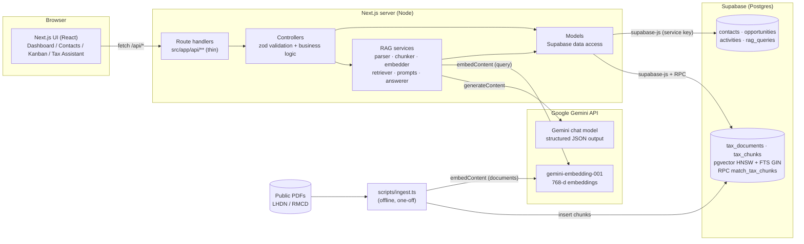

# Architecture

## 1. System overview

A single Next.js (App Router, TypeScript) application serves both the UI and the backend API, organised as **MVC**. Supabase (Postgres + pgvector) is the only datastore. Google Gemini provides both the embedding model and the answer-generation LLM.

### Component diagram (draft — to be redrawn in draw.io)



ASCII fallback:

```
 Browser (React UI) --HTTP--> Next.js route handlers --> Controllers --> Models --> Supabase Postgres
                                                              |                    (CRM tables + pgvector)
                                                              +--> RAG services --> Gemini Embeddings API
                                                                                +--> Gemini LLM API
 Offline:  PDFs --> scripts/ingest.ts --> Gemini Embeddings --> tax_chunks (pgvector)
```

### MVC mapping

| Layer | Location | Responsibility |
|---|---|---|
| View | `src/app/**` pages, `src/components/**` | Rendering, forms, Kanban, chat UI |
| Controller | `src/controllers/**`, `src/app/api/**/route.ts` | Route handlers parse the request and delegate; controllers validate with zod and hold business rules |
| Model | `src/models/**` | All SQL/Supabase access; no HTTP concerns |
| AI services | `src/services/rag/**` | The RAG pipeline, called by `rag.controller.ts` |

Every API response uses one envelope: `{ "data": ... }` or `{ "error": "..." }`.

## 2. Data model

```mermaid
erDiagram
  contacts ||--o{ opportunities : "has"
  contacts ||--o{ activities : "logged against"
  opportunities ||--o{ activities : "logged against"
  contacts ||--o{ rag_queries : "asked about"
  tax_documents ||--o{ tax_chunks : "split into"

  contacts { uuid id PK; text name; text email; text phone; text company; text status "Lead|Prospect|Customer" }
  opportunities { uuid id PK; uuid contact_id FK; text title; numeric value_rm; text stage "New|Contacted|Qualified|Proposal|Won|Lost" }
  activities { uuid id PK; uuid contact_id FK; uuid opportunity_id FK; text type "Call|Email|Meeting|Note"; timestamptz activity_date; text description }
  tax_documents { uuid id PK; text name; text category; text source_url UK; int page_count; int chunk_count }
  tax_chunks { uuid id PK; uuid document_id FK; int chunk_index; int page_start; int page_end; text section; text content; vector768 embedding; tsvector fts }
  rag_queries { uuid id PK; uuid contact_id FK; text question; text answer; jsonb citations; bool answerable }
```

Notes
- Enumerations (status / stage / type) are enforced with `CHECK` constraints, mirrored by zod enums and shared TypeScript types in `src/types`.
- `activities` has a CHECK that at least one of `contact_id` / `opportunity_id` is set; when only an opportunity is given the controller fills `contact_id` from it.
- Deleting a contact cascades to its opportunities and activities; deleting a contact only nulls `rag_queries.contact_id` (history is kept).
- `tax_chunks.fts` is a generated `tsvector` column; indexes: HNSW (`vector_cosine_ops`) on `embedding`, GIN on `fts`.
- The DDL lives in [`supabase/migrations/0001_init.sql`](supabase/migrations/0001_init.sql).

## 3. RAG and AI integration design

| Concern | Decision |
|---|---|
| **Sources** | 9 public PDFs: 2 LHDN e-Invoice guidelines, 4 RMCD Service Tax / SST guides, 3 LHDN public rulings (see `data/sources.json`). |
| **Parsing** | `pdf-parse` v2, per-page text so every chunk keeps a page range. Cleaning drops table-of-contents dot-leader lines, bare page numbers and repeating headers/footers (the e-Invoice guides' "List of Tables" polluted early chunks). |
| **Chunking** | Paragraph/line-aware packing to **~3,000 characters (~750 tokens)** with **~450 characters (~15%) overlap**, never splitting inside a line. Each chunk records `page_start/page_end` and a best-effort `section` (numbered or ALL-CAPS heading). 229 chunks total, mean ≈2,400 chars, max 3,000. |
| **Embedding model** | `gemini-embedding-001`, `outputDimensionality=768`, `taskType=RETRIEVAL_DOCUMENT` for chunks and `RETRIEVAL_QUERY` for questions. Vectors are L2-normalised in code (Gemini does not normalise truncated dimensions). The embedded text is prefixed with document name and section so the heading context is searchable. |
| **Vector store** | Supabase Postgres + **pgvector** `vector(768)` with an **HNSW** cosine index. Chosen because the CRM already lives in Postgres: one datastore, SQL metadata filters, and transactional ingestion. |
| **Retrieval** | Hybrid search in a SQL function (`match_tax_chunks`): cosine top-N from pgvector **plus** Postgres full-text search, fused with **Reciprocal Rank Fusion** (k=60). Candidate pool = max(12, 2×top-k), final **top-k = 6**. Optional **metadata filter** on document `category`. |
| **Filtering / "reranking"** | LLM-free guard: a candidate below `RAG_MIN_SIMILARITY` (0.45) is dropped unless it has a lexical keyword hit (≥2 distinct question keywords). RRF acts as the rerank step; no cross-encoder reranker (see §8). |
| **Prompt design** | System prompt in `src/services/rag/prompts.ts`: answer **only** from numbered passages, cite as `[n]`, never infer rates/dates not in the context, ignore instructions found inside passages (prompt-injection hygiene), concise practical style. Each passage is rendered as `[n] <document>, page(s), section` + text. |
| **Structured output** | `responseMimeType: application/json` with a response schema `{answerable, answer, used_sources[]}` and temperature 0.1. |
| **Citations** | Citation objects (`document_name`, page range, section, `source_url`, excerpt) are built **in code** from the chunk records the model says it used (`used_sources`, plus `[n]` markers in the text), validated against the numbered context. Markers that don't map to a real passage (e.g. the model echoing a paragraph number) are stripped. |
| **Hallucination guard** | (1) zero retrieved chunks → LLM is skipped, fixed refusal returned; (2) prompt rule + `answerable=false` → fixed sentence *"I cannot find this in the knowledge base."*; (3) if the model claims `answerable` but cites nothing valid → refused. |
| **CRM link** | With a `contact_id`, the controller loads the contact and their open opportunities and adds a "Client context" block to the prompt (tailoring only, explicitly *not* citable). Every Q&A is stored in `rag_queries`, so it appears in the contact's history. |
| **Error handling** | Retries with exponential backoff on 429/500/503 for both embedding and generation; one-shot fallback to `GEMINI_CHAT_FALLBACK_MODEL`; Gemini outages surface as HTTP 503 with a readable message; invalid LLM JSON → 500 with a retry hint; unknown `contact_id` → 404; request bodies validated with zod (422). Ingest backs off on embedding 429s and is idempotent. |

## 4. API surface

| Method & path | Purpose |
|---|---|
| `GET/POST /api/contacts` · `GET/PUT/DELETE /api/contacts/:id` | Leads CRUD; list supports `search`, `status`; detail includes opportunities + activities |
| `GET/POST /api/opportunities` · `GET/PUT/DELETE /api/opportunities/:id` | Opportunities; filter by `contact_id`, `stage`; PUT also moves Kanban stage |
| `GET/POST /api/activities` · `DELETE /api/activities/:id` | Activity log; filter by contact / opportunity |
| `GET /api/dashboard` | Totals, open pipeline value, recent activity |
| `POST /api/rag/ask` · `GET /api/rag/history` · `GET /api/rag/documents` | RAG Q&A, history, knowledge-base listing |

## 5. Security notes

- No authentication (per the brief). RLS is **enabled** on every table with open policies, so the intent is explicit; in production this becomes per-user policies behind Supabase Auth.
- The service-role key is only read server-side (`src/lib/env.ts`, route handlers, scripts) and never sent to the browser; `.env` is git-ignored and `.env.sample` is committed.
- Because the publishable key can read/write under the open policies, **a real deployment must not ship with these policies** (see §8).

## 6. Engineering notes

- Next.js 16 with `cacheComponents` is on: route files must not export segment config (`runtime`, `maxDuration`, `dynamic`), and `params` / `usePathname()` must sit under `<Suspense>` on dynamic routes. `next build` passes (all 15 routes).
- Gemini model availability is volatile (e.g. `gemini-2.5-flash` returned 404 for this key; some newer models returned 503 under load), hence configurable model names, retries and a fallback model.

## 7. Evaluation results

Setup: 9 documents / 229 chunks, hybrid retrieval, top-k 6, similarity floor 0.45, chat model `gemini-3.6-flash`. Questions and expected sources: [`data/eval-questions.json`](data/eval-questions.json). Raw results: [`data/eval-results.md`](data/eval-results.md) / `.json`. Reproduce with `npm run eval`.

| Metric | Result |
|---|---|
| Retrieval hit rate @6 (expected document in top 6) | **10 / 10 (100%)** |
| Hit @1 (expected document ranked first) | 10 / 10; MRR = 1.0 |
| Exact-page hit @6 | 10 / 10 (rank 1 for 8, rank 2 for q3, rank 3 for q5) |
| In-scope answers containing the expected fact, with citations | 10 / 10 |
| Out-of-scope questions correctly refused (Singapore corporate tax; sourdough recipe) | 2 / 2 |

Questions covered e-Invoice phase-in dates and rejection windows, service-tax registration thresholds, SST-02 deadlines and penalties, the service-tax rate on management services, the 182-day residence rule, the charitable-gift deduction limit, professional services schedule groups, and e-Invoice foreign-currency rules.

What I learned
1. **Document-level hit rate is easy here, so it flatters the system.** With only 9 documents on distinct topics, 100% hit@6 says little; the *page-level* rank (q3 rank 2, q5 rank 3) is the more honest signal, and a larger/overlapping corpus (e.g. several SST guides covering the same rules) would be a harder test.
2. **Cleaning mattered more than chunk size.** Tables of contents and "List of Tables" sections ranked well for generic queries until stripped. Prefixing chunks with document name + section also helped.
3. **The similarity floor alone does not catch out-of-scope questions.** "Corporate tax in Singapore" retrieved at 0.605 similarity (above the floor) because Malaysian corporate-tax text is lexically close; the *LLM guard* did the refusing. Two layers are needed.
4. **The model sometimes echoes source paragraph numbers as citations** (e.g. `[26]`). Citations are therefore built and validated in code, not trusted from the text.
5. **Operational:** embedding rate limits (429) dominate ingest time; model deprecations are a real production risk.
6. **Caveat:** 12 questions written by the same author who built the pipeline is a small, friendly test set; expected-fact checks are string-based.

## 8. What I would do differently with more time

- **Auth and real security.** Supabase Auth, per-user RLS, a server-only service key (no open anon policies), rate limiting on `/api/rag/ask` to protect the Gemini quota.
- **Better evaluation.** A larger, adversarial set (near-duplicate documents, multi-document questions, ambiguous questions), LLM-as-judge or human grading for answer faithfulness, and tracking recall/precision of citations, not just document hit rate. Run it in CI.
- **Retrieval quality.** A cross-encoder / LLM reranker on the top 20, section-aware (heading-tree) chunking and table extraction (many tax answers live in tables that plain text extraction mangles), query rewriting for follow-up questions, and conversation memory in the chat.
- **Ingestion.** Background job with progress and re-ingest on document change (content hash), OCR for scanned PDFs, versioning of rulings (which ruling version applies on which date), and an admin UI to upload documents.
- **Answer UX.** Stream tokens, highlight the cited passage in a PDF viewer at the right page, "was this helpful" feedback stored for tuning.
- **CRM depth.** Pagination and server-side sorting, activity editing, a dedicated activity page, optimistic-concurrency on Kanban moves, tests (unit tests for controllers, Playwright for the Kanban and chat flows), and generated Supabase types instead of hand-maintained ones.
- **Ops.** Observability for LLM calls (latency, tokens, refusal rate), prompt versioning, secrets in a vault, and a CI pipeline running lint, typecheck, build and the retrieval eval.
